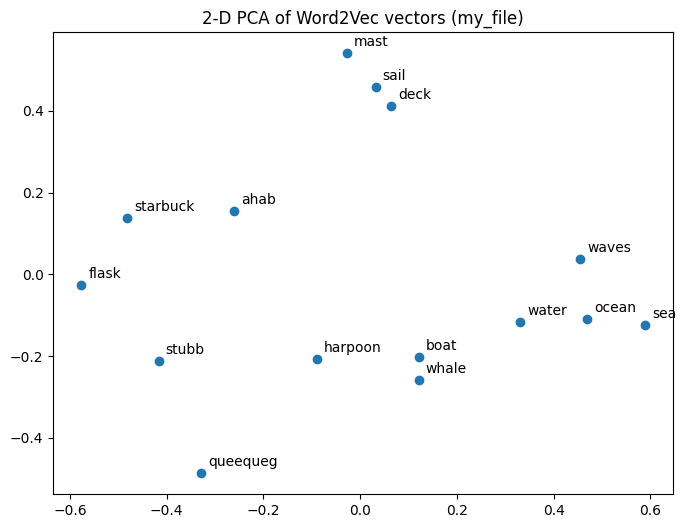
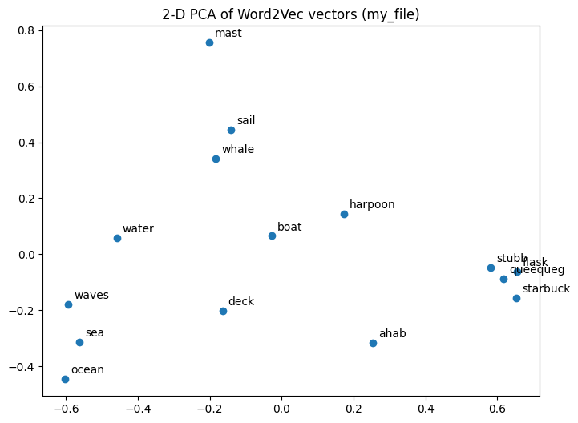
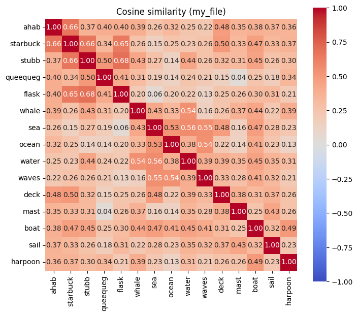
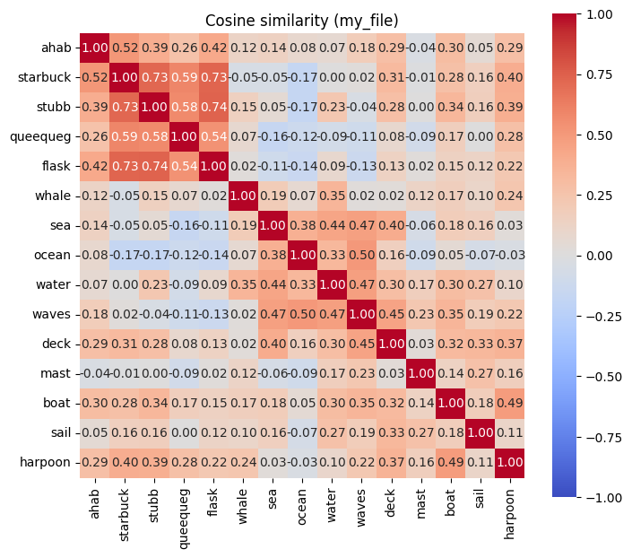

# Word2Vec on Moby Dick

Training Word2Vec on Herman Melville's *Moby-Dick* (Project Gutenberg #2701) and comparing skip-gram with CBOW, plus a practical application: grouping government purchase lines to find consolidation opportunities.

## Contents

| Path | What it is |
|---|---|
| `Word2Vec_Moby_Dick.ipynb` | The notebook, with outputs from both runs and the reflection answers. Open it in Google Colab and run the cells top to bottom. |
| `images/` | The PCA plots and cosine heatmaps from both runs. |
| `app/spend-grouper.html` | Spend Grouper, a web app that applies Word2Vec to procurement data. Open it in any browser. |
| `app/engine.js` | The app's Word2Vec, grouping and CSV code as a standalone script. |

## The notebook

The notebook follows the class "Build your own Word2Vec" template. The original `# TODO` comments and hints are kept, with each answer written directly under them.

1. Downloads *Moby-Dick* from Project Gutenberg (215,845 words).
2. Loads it as one sentence per line (18,922 lines, 212,079 words).
3. Trains two models with the same settings, changing only the method:

| Setting | Value | Why |
|---|---|---|
| Vector size | 50 | The book is relatively small, so 50 numbers per word is enough without picking up noise |
| Window | 5 | Each line is only about 10 to 12 words, so 5 on each side covers most of it |
| Min count | 5 | Rarer words get random neighbors |
| Negative | 10 | Small texts learn better with more noise words |
| Epochs | 30 | A small text needs more passes |
| Method | Run 1: skip-gram (`SG = 1`), Run 2: CBOW (`SG = 0`) | The one setting changed for comparison |

Both runs learned a vocabulary of 4,267 words.

### Results at a glance

| | Skip-gram | CBOW |
|---|---|---|
| Neighbors of "whale" | sperm, whales, beheaded, heidelburgh, folio | whales, hump, bears, whalemen, tun |
| Neighbors of "ahab" | starbuck, mayhew, advancing, fiend, whisper | voice, peleg, sleet, bildad, mayhew |
| ahab–captain similarity | 0.453 | 0.240 |
| captain − ahab + queequeg | hussey, mend, said, signs, peleg | thinks, signs, said, proceedings, mend |

**Main finding:** skip-gram connected words that appear in the same scenes, while CBOW connected words that can be swapped for each other.

| Skip-gram | CBOW |
|---|---|
|  |  |
|  |  |

## Spend Grouper

A practical use of the same idea for a county government's ERP data. Purchase lines often describe the same item many ways ("HEX SCREW M8 SS", "Hx Scrw M8 Stainless"). Spend Grouper:

- trains Word2Vec (CBOW or skip-gram) in the browser on purchase-line descriptions
- groups lines that describe the same item
- flags items bought by 4 or more departments from 3 or more vendors, with at least half the spend off contract, as candidates for a shared contract
- lists abbreviations the model learned on its own (scrw → screw, glvs → gloves, vlv → valve)

It opens with 6,000 **fictional** purchase lines. These are not real Miami-Dade County records. You can upload your own CSV export and match its columns; the file stays in the browser and is never uploaded anywhere.

On the sample data, CBOW at strictness 0.70 grouped every line into the correct item type. Flagged groups are leads for a buyer to review, not decisions.
